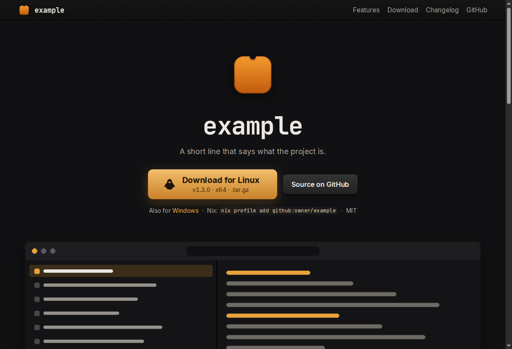
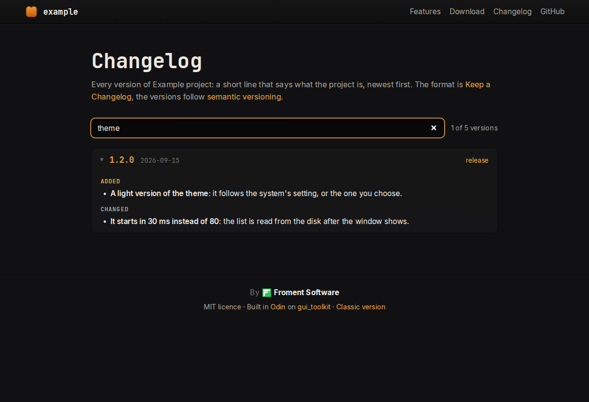

# Modern site template

A template for a project website in the modern style, the one of
[papier](https://papier.froment.software/), [classeur](https://classeur.froment.software/) and
[inspecteur](https://inspecteur.froment.software/). You write one home page and keep a `CHANGELOG.md`; the build makes
the rest.

[Demo](https://sachahjkl.github.io/modern-site-template/) (the example content below, built by this repository's workflow)



## What the build makes

From `site/index.html` and `CHANGELOG.md`, `sitetool site build` writes:

- **the home page**, with:
  - a download button for the reader's system (Windows, Linux or macOS), the other systems on the line under it;
  - "What's new": the last three versions of the changelog, and a button to all of them;
  - `{{version}}` replaced by the last version, so a download link names the file of that release;
- **`changelog.html`**: every version, with a filter by a word or a version;

  

- **`classic/`**: the same site in the classic style (a nav line of plain links, a NEWS column). Each page's footer links the
  other version;
- what a page says when it is shared (Open Graph, Twitter, a canonical address, structured data), `feed.xml` (Atom),
  `sitemap.xml`, `site.webmanifest`, `llms.txt` and a `404.html`.

The steps are [gui_toolkit](https://github.com/sachahjkl/gui_toolkit)'s `site` package
([its documentation](https://github.com/sachahjkl/gui_toolkit/blob/master/docs/site.md)), in the submodule `ext/gui_toolkit`.
`tools/sitetool` is a small Odin program that calls them: its commands are the toolkit's `site` and `changelog` commands
(`gt:toolbox`'s `tool_main`).

## Using the template

1. Press **Use this template** on GitHub, then clone your repository with its submodule: `git clone --recursive`.
2. Edit only these:
   - `tools/sitetool/site.odin`: the address, the name, the tagline, the colours of the browser's bar, the author, the
     download per system;
   - `site/index.html`: the content. Keep the parts the build looks for: `<!-- whats-new -->`, `<!-- download -->` and
     `<!-- download-others -->`, the `hero` section, `figure.shot.wide`, the `features` cards, `section.gallery`, the
     `download` section, `nav#nav`, and `<a href="classic/">Classic version</a>` in the footer. If one is missing, the
     build says which;
   - `site/style.css`: the colours, as tokens at its top (`--accent` and the four after it);
   - `site/img/`: the logo, the pictures, the maker's mark of the footer;
   - `CHANGELOG.md`: [Keep a Changelog](https://keepachangelog.com/en/1.1.0/), `## [x.y.z] - yyyy-mm-dd` sections and the
     versions' links at its end. In a project, the changelog of the program itself.
3. Push to `master`. The workflow `.github/workflows/pages.yml` builds the site and deploys it to GitHub Pages
   (Settings > Pages > Source: GitHub Actions). Pages needs a public repository, or a paid plan for a private one.

Everything in `site/`, `CHANGELOG.md` and `tools/sitetool/site.odin` is example content about a fictional "Example
project": replace it.

In a program's own repository, put `site/` in it and add `site.command` to its tool, with the content of
`tools/sitetool/site.odin` (papier's `tools/papiertool` is one).

## Building it on your machine

`nix develop` gives Odin and the commit hooks. Then:

```sh
./build.sh site build site build/site
```

(`build.sh` and `build.bat` run `odin run tools/sitetool -collection:gt=ext/gui_toolkit/src -out:build/sitetool -- <command>`;
`./build.sh help` lists the commands.)

`build/site` is the site; serve the folder with any static server to see it. Other commands:

- `sitetool site check [--shot file.png]`: the pages in a real browser (Chrome, Chromium or Edge), served on this machine: a
  missing image, a broken link or a script error fails it;
- `sitetool site card`: draws the picture a shared link shows again, in a local browser;
- `sitetool changelog new <type> <text>`, `check`, `preview`: the fragments of `changelog.d/`, one per change a user can see
  (`changelog.d/README.md`).

`nix build` makes the same site in `result/`, and `nix flake check` builds it and runs the hooks.

## Licence

MIT. See [LICENSE](LICENSE).
